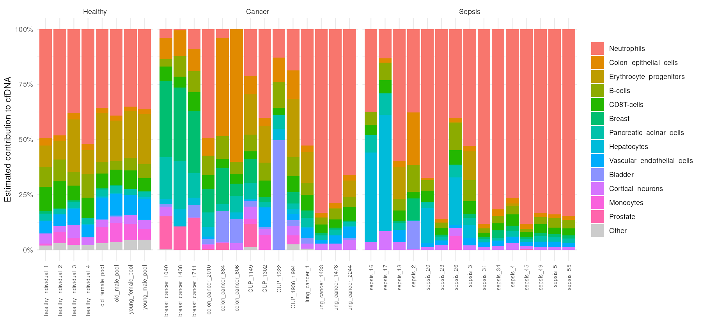
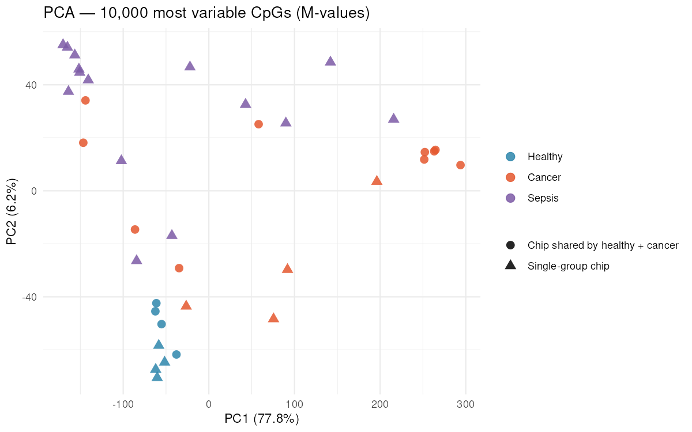
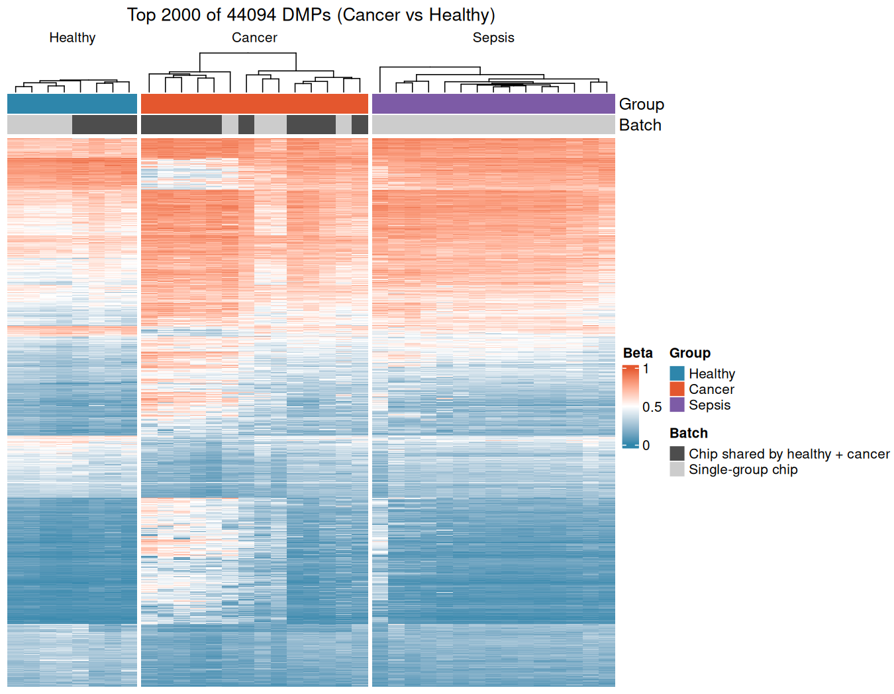
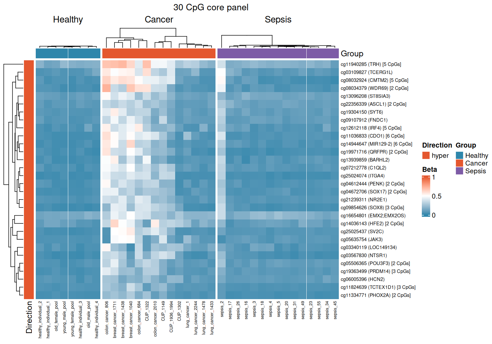
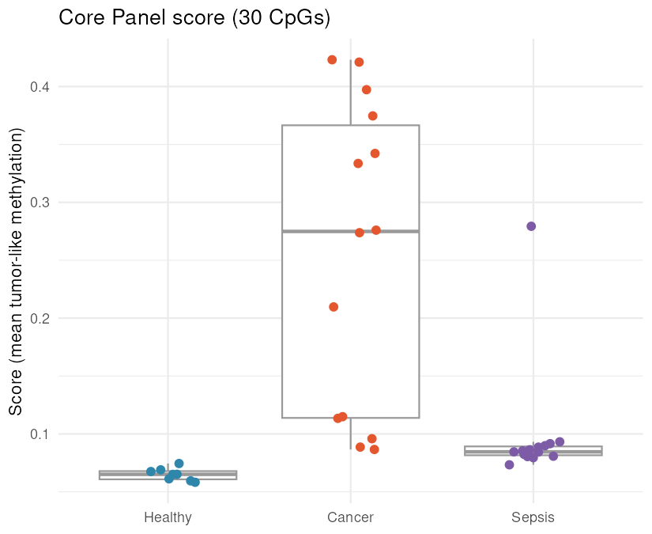

# cfdna-methylation-arrays

[](https://github.com/NicoCosta4/cfdna-methylation-arrays/actions/workflows/docker-image.yml)

Reproducible analysis of **cell-free DNA (cfDNA) methylation** from Illumina EPIC arrays, packaged in a Docker container: quality control, normalization, tissue-of-origin deconvolution, differential methylation and a **biomarker selection** that removes signals coming from blood cells or from systemic inflammation, ending in a compact 30-CpG panel.

## Dataset

Plasma cfDNA profiled on the EPIC array, from [GSE122126](https://www.ncbi.nlm.nih.gov/geo/query/acc.cgi?acc=GSE122126):

> Moss J, *et al.* Comprehensive human cell-type methylation atlas reveals origins of circulating cell-free DNA in health and disease. *Nature Communications* 9, 5068 (2018). [doi:10.1038/s41467-018-07466-6](https://doi.org/10.1038/s41467-018-07466-6)

49 arrays from 37 biological units (technical replicates — same person or pool at a different DNA input, or repeated arrays — are averaged so every unit counts once):

| Group | Units | Arrays | Composition |
|---|---:|---:|---|
| Healthy | 8 | 12 | 4 individuals + 4 plasma pools (young/old × male/female), pools in duplicate |
| Cancer | 14 | 15 | Colon (3), breast (3), non-small-cell lung (3), small-cell lung (1), cancer of unknown primary (4) |
| Sepsis | 15 | 22 | Inflammation control: high neutrophil-derived cfDNA, no known tumor |

The sample sheet is built from the GEO metadata by [`scripts/build_samplesheet.R`](scripts/build_samplesheet.R).

### Design caveats

- **Batch structure.** 8 healthy arrays (the pools) share a chip of their own, and all sepsis samples are on sepsis-only chips. Three chips hold both healthy individuals and cancer patients; a sensitivity analysis restricted to them (chip as covariate) checks robustness to batch effects. Comparisons involving sepsis remain confounded with chip.
- **Two EPIC revisions** (1,052,641 vs 1,051,815 probes) are combined on their shared probes.
- **Age**: cancer patients are older than the healthy individuals; pools have no age. Sex-chromosome probes are removed.
- Small groups: results are exploratory and need validation in an independent cohort.

## Pipeline

| Step | Script | What it does |
|---|---|---|
| 0 | `00_download_data.R` | Downloads the 98 IDATs (retries, discards truncated files) and the Moss et al. reference atlas (pinned commit + checksum) |
| 1 | `01_qc.R` | Detection p-values, intensity QC, chips per group |
| 2 | `02_normalization.R` | `preprocessQuantile`, probe filtering, averaging of technical replicates |
| 3 | `03_deconvolution.R` | Tissue of origin of each cfDNA sample (NNLS on the Moss et al. atlas) |
| 4 | `04_dmp.R` | `limma` on M-values: Cancer vs Healthy, Sepsis vs Healthy, and the shared-chip sensitivity analysis |
| 5 | `05_figures.R` | PCA, volcano plot, heatmap |
| 6 | `06_biomarker_references.R` | Downloads and summarizes purified leukocyte methylomes and TCGA tumor/normal tissue (run once, ~2.5 GB) |
| 7 | `07_biomarkers.R` | Biomarker funnel, signature and core panel |

All thresholds live in [`config/config.yml`](config/config.yml).

## Quick start

Requirements: [Docker](https://docs.docker.com/get-docker/) and ~15 GB of free disk space (image, IDATs and TCGA references).

```bash
git clone https://github.com/NicoCosta4/cfdna-methylation-arrays.git
cd cfdna-methylation-arrays
docker build -t cfdna-methylation-arrays .

for step in 00_download_data 01_qc 02_normalization 03_deconvolution 04_dmp 05_figures \
            06_biomarker_references 07_biomarkers; do
  docker run --rm -v "$PWD":/project cfdna-methylation-arrays Rscript scripts/$step.R
done
```

On x86_64 servers the image can be pulled instead of built (`ghcr.io/nicocosta4/cfdna-methylation-arrays:latest`), or converted for Singularity/Apptainer:

```bash
singularity pull cfdna.sif docker://ghcr.io/nicocosta4/cfdna-methylation-arrays:latest
singularity exec cfdna.sif Rscript scripts/01_qc.R
```

## Results

### Quality control

All 49 arrays pass QC (median failed probes 0.2–0.7% per group, maximum 2.5%; the weakest arrays are the 50 ng inputs). After filtering, **734,543 CpGs** remain ([filtering table](results/tables/02_probe_filtering.csv)).

### Tissue of origin



Deconvolution recovers the expected biology: healthy cfDNA is ~81% blood-derived with a stable profile; **breast cancers show a 28–35% breast signal and colon cancers up to 60% colon epithelium**; one cancer of unknown primary shows a 50% bladder signal; sepsis is dominated by neutrophils (median 77% vs 39% in healthy donors), with hepatocyte signal in some patients ([group comparison](results/figures/03_fractions_by_group.png)).

### Differential methylation (Cancer vs Healthy)

**44,094 DMPs** (FDR < 0.05, |Δβ| ≥ 0.1): 25,282 hyper- and 18,812 hypomethylated ([summary](results/tables/04_dmp_summary.csv)). In the shared-chip sensitivity analysis all of them keep the same direction (Δβ correlation 0.993) and 44% stay nominally significant despite the much smaller sample.

Many of these changes are **not tumor-specific**: cancer cfDNA contains less blood-derived DNA (60% vs 81%), and the heatmap shows that a large block of DMPs changes the same way in sepsis.

| PCA | Top 2,000 DMPs (sepsis shown alongside) |
|---|---|
|  |  |

### Biomarker funnel

Each filter asks a question a cfDNA biomarker must answer:

| Filter | Question | Data | Hyper | Hypo | Total |
|---|---|---|---:|---:|---:|
| 1 | Differs between cancer and healthy cfDNA? | This dataset | 25,282 | 18,812 | 44,094 |
| 2 | Not reproduced by systemic inflammation? | Sepsis vs healthy | 9,798 | 11,410 | 21,208 |
| 3 | Opposite state in every leukocyte type (low blood background)? | [FlowSorted.Blood.EPIC](https://bioconductor.org/packages/FlowSorted.Blood.EPIC/) | 5,514 | 6,524 | 12,038 |
| 4 | Altered the same way in the tumors themselves? | TCGA colon, breast, lung (20 tumors + 20 normals each) | 3,720 | 1,485 | **5,205** |

The top of the resulting [signature](results/tables/07_signature.csv) is made of CpG-island loci in developmental genes that are frequently hypermethylated in cancer (e.g. *TFAP2E*, *VENTX*, *PRDM14*, *OSR1*, *TRH*).

### Core panel (30 CpGs)

An assay-sized subset of the signature ([table](results/tables/07_core_panel.csv)), built with criteria that favour biological interpretability and targeted-assay design:

- **hypermethylated** (gain of methylation is more robust to detect in cfDNA than loss),
- located in a **CpG island of a gene promoter**,
- altered in **all four TCGA tumor types**, with **β ≤ 0.1 in every leukocyte type**,
- **one CpG per gene** (the most significant), ranked by cfDNA significance.

For each gene, `cpgs_in_gene` counts how many CpGs of that promoter island pass every criterion: several consecutive CpGs point to a regional methylation change rather than a single noisy probe. **16 of the 30 genes are supported by more than one CpG** (up to 6 for *CDO1* and *MIR129-2*; 5 for *TRH*, *CMTM2* and *IRF4*).

Panel genes: *ASCL1, BARHL2, C1QL2, CDO1, CMTM2, EMX2/EMX2OS, FNDC1, HCN2, HFE2, IRF4, ITGA4, JAK3, LOC149134, MIR129-2, NR2E1, NTSR1, PENK, PHOX2A, POU3F3, PRDM14, QRFPR, SOX17, SOX8, ST8SIA3, SV2C, SYT6, TCERG1L, TCTEX1D1, TRH, WDR69*.

| Panel heatmap | Panel score per sample |
|---|---|
|  |  |

The panel score (mean methylation of the 30 CpGs) is tightly clustered in healthy donors (0.058–0.074), and all 14 cancer patients score above the highest healthy donor. Breast, colon and most unknown-primary cancers score far higher (0.21–0.42). Lung cancers score low (0.087–0.113) and overlap with sepsis (0.073–0.093), consistent with their low non-blood fraction in the deconvolution. One sepsis patient scores 0.28; its cfDNA also shows a 24% colon-epithelium signal.

### Limitations

- **Optimistic separation**: the panel is selected in the same samples it is scored on. Filters 2–4 rely on independent data, which reduces but does not remove this bias. An independent validation cohort is needed.
- Sepsis comparisons are confounded with chip, so filter 2 is indicative.
- CpGs absent from the 450K array cannot be checked against TCGA and do not pass filter 4.

## Reproducibility

The Docker image pins R 4.6.1 and Bioconductor 3.23, and is built and published by GitHub Actions. Rebuilding the image and rerunning the pipeline reproduces identical result tables. The random TCGA sample selection is stored in [`reference/tcga_samples.csv`](reference/tcga_samples.csv) and reused on later runs.

The Moss et al. atlas is distributed under a research-only license that does not allow redistribution, so it is downloaded at run time (pinned to a commit and checked by MD5) instead of being included in this repository.

## Repository structure

```
├── .github/workflows/          # builds and publishes the Docker image
├── Dockerfile                  # pinned R/Bioconductor environment
├── docker/install_packages.R   # package list; the build fails if any is missing
├── config/
│   ├── config.yml              # all analysis and biomarker parameters
│   └── samplesheet.csv         # 49 arrays, units, groups, chips
├── reference/                  # cross-reactive probes, TCGA sample selection
├── scripts/                    # one script per pipeline step
└── results/
    ├── figures/
    └── tables/
```

## License

Code: [MIT](LICENSE). Data belong to their original authors (GEO GSE122126, GSE110554 via FlowSorted.Blood.EPIC, TCGA).
